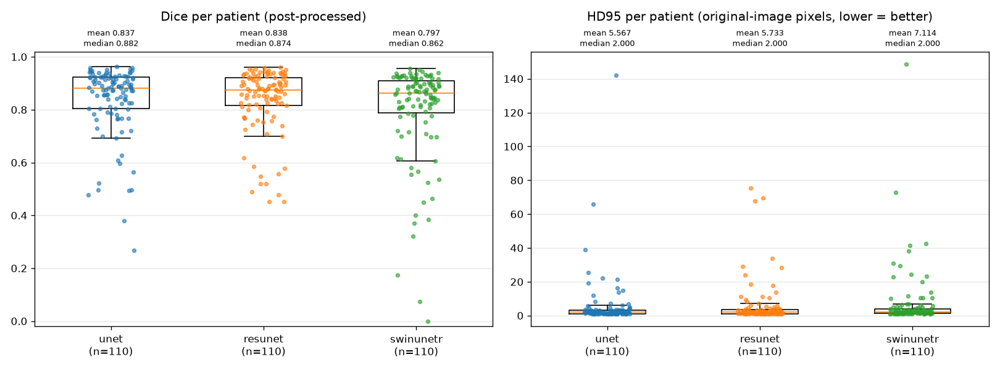
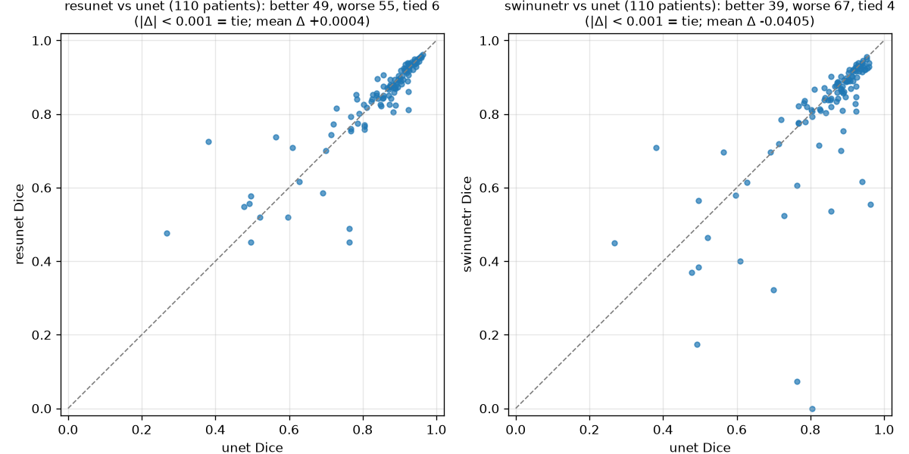
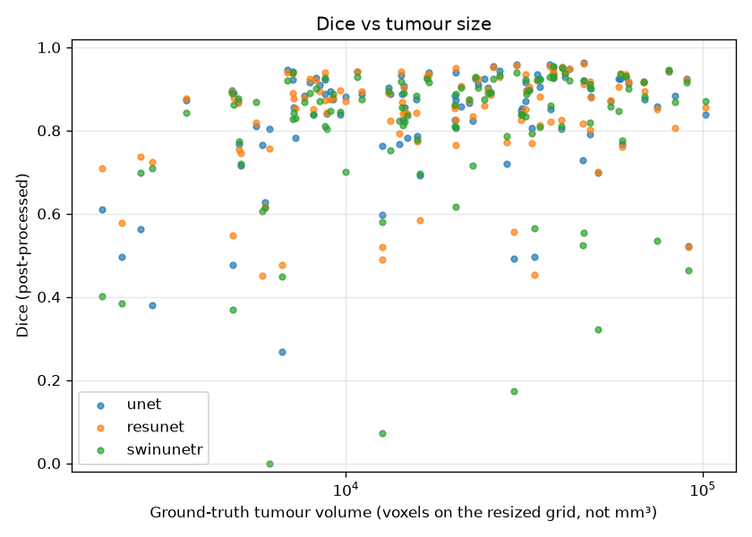
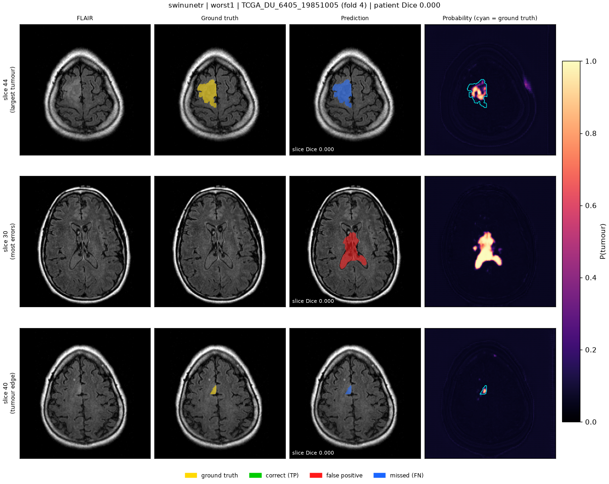
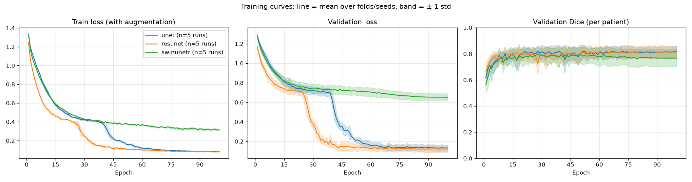
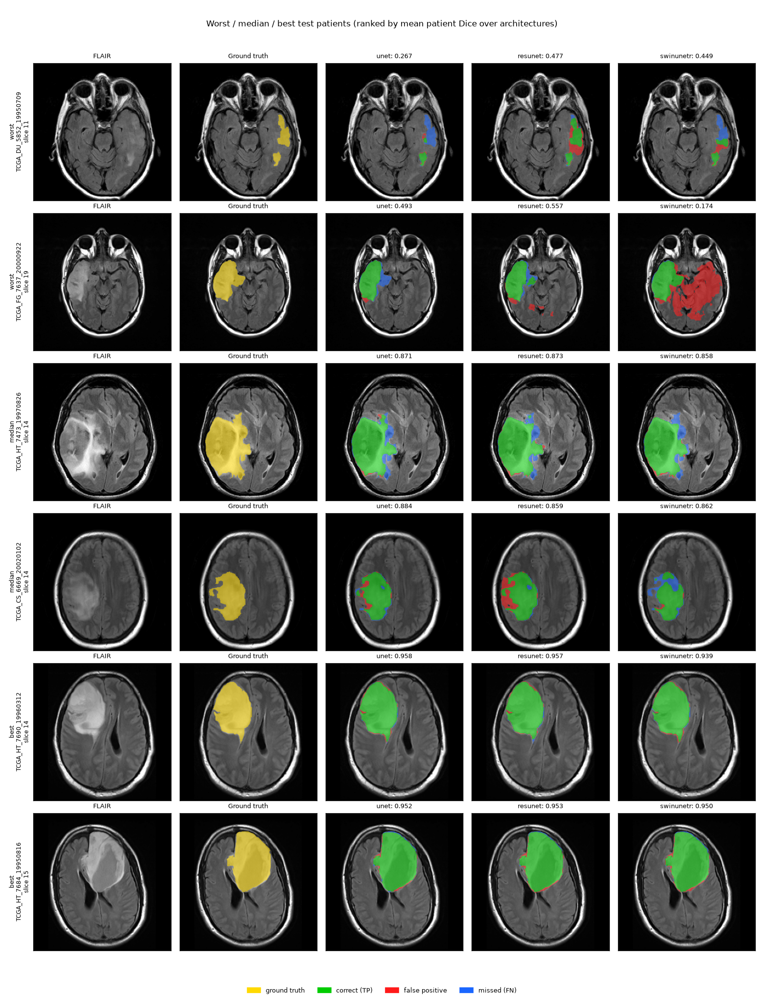
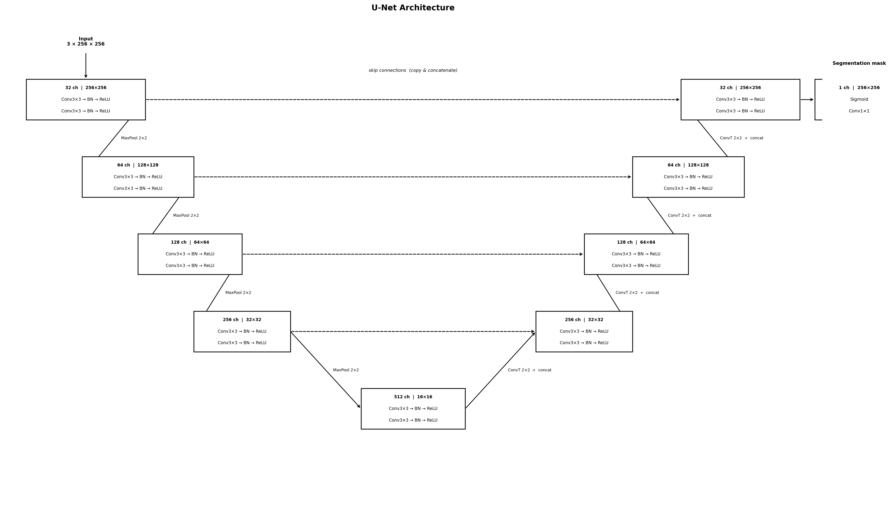

# Brain MRI tumour segmentation: U-Net vs ResU-Net vs Swin-UNETR

[](https://github.com/onurunaall/Brain-MRI-Segmentation/actions/workflows/tests.yml)

[](LICENSE)

I built this project on my own time to learn medical image segmentation properly, end to end: from TIFF slices on
disk to a cross-validated comparison of three architectures, and models exported for ONNX Runtime and TensorRT. The
task is to outline FLAIR abnormalities (lower-grade gliomas) in brain MRI, using the
[LGG Segmentation Dataset](https://www.kaggle.com/datasets/mateuszbuda/lgg-mri-segmentation): 110 patients from The
Cancer Genome Atlas, with manual tumour masks.

The question I wanted to answer was simple: on a dataset this small, does a transformer-based model actually beat a
plain U-Net once the evaluation is done carefully? In my runs it does not. A residual U-Net ties with the plain U-Net,
and Swin-UNETR is clearly worse, mostly because of a handful of patients where it fails badly.

## Results

Every patient is tested exactly once, by a model that never saw it during training: patient-level 5-fold
cross-validation, with 22 test patients, 78 training patients and 10 validation patients (to pick the checkpoint) per
fold. All three architectures use the same folds, loss, schedule and augmentation. Scores are measured in the
original image pixels against the masks on disk, every slice included.

| | U-Net | ResU-Net | Swin-UNETR |
|---|---|---|---|
| Mean Dice ± SD over patients | **0.837** ± 0.132 | **0.838** ± 0.121 | 0.797 ± 0.185 |
| Median Dice | 0.882 | 0.874 | 0.862 |
| Worst patient | 0.267 | 0.452 | 0.000 |
| Patients below 0.5 | 6 | 4 | 9 |
| Mean Dice without post-processing | 0.832 | 0.835 | 0.791 |
| Median HD95 (pixels) | 2.0 | 2.0 | 2.0 |
| Difference to U-Net (Wilcoxon signed-rank) | | +0.0004 (p = 0.71) | -0.041 (p < 0.001) |
| SD of the five fold means | 0.034 | 0.034 | 0.035 |
| Parameters | 7.8 M | 8.1 M | 6.3 M |
| Peak training memory | 1.4 GB | 1.7 GB | 2.6 GB |
| Training time per epoch (RTX A6000) | 17 s | 16 s* | 17 s |

110 test patients per architecture, one training seed per fold (15 training runs, 100 epochs each). I am rerunning
everything with three seeds per fold, so the comparison also covers seed-to-seed noise; these numbers will be updated
when it finishes. The raw per-patient results are in [`results/`](results/).

\* ResU-Net folds 0 to 2 ran while someone else was using the same GPU on our shared workstation (56 to 74 s per
epoch), so this is the mean of folds 3 and 4.



### What I learned from it

**ResU-Net and U-Net are a tie.** Compared patient by patient, ResU-Net is better on 49 patients and worse on 55, with
a mean difference of +0.0004. At this data size the residual blocks did not buy anything.

**Swin-UNETR loses on the hard cases, not on the typical one.** Its median is only 0.02 below U-Net's, but it has
more outright failures (9 patients below 0.5 against 6), which pulls its mean down by 0.04. It is worse than U-Net on
67 of the 110 patients. My guess is that 78 training patients are too few for a transformer trained from scratch, and
that the learning rate and schedule I used for all three models suit the convolutional ones better. I have not tested
that guess.



**Small tumours are the hardest.** The 9 patients with the smallest tumours (under 5,000 voxels on the 256 × 256 grid)
average a Dice of 0.67 with U-Net, against 0.85 for everyone else. A small tumour has few pixels compared to its
boundary, so every boundary pixel the model gets wrong costs more. ResU-Net held up best there (0.76).



**Post-processing helps on average and can wreck a single case.** After thresholding, the prediction can be cleaned
up by dropping small 3D blobs or by keeping only the largest connected component. Each model picks the option that
works best on its 10 validation patients. On average this adds 0.003 to 0.006 Dice. But Swin-UNETR on fold 4 picked
"largest component only" (validation Dice 0.735 against 0.723 without), and on patient TCGA_DU_6405 its largest
component was a confident false positive around the lateral ventricles. The real tumour, which it had partly found,
was deleted, and the patient's Dice went from 0.245 to 0.000:



A choice made on 10 patients over a difference of 0.01 is mostly noise. A safer rule would only pick the more
destructive option when it wins clearly.

**The sudden drop in the loss curves is not what it looks like.** U-Net's validation loss falls from about 0.7 to 0.13
around epoch 40 (ResU-Net around epoch 28), and the validation Dice does not move at all.



The loss is soft Dice plus binary cross-entropy, computed per slice. On a slice without tumour, the soft Dice term with
a smoothing constant of 1 is 1 - 1/(sum of probabilities + 1). That stays close to 1 until the probabilities over the
whole slice add up to less than about one pixel's worth. More than half of the validation slices have no tumour, so
they contribute roughly 0.5 to 0.6 to the loss until the network pushes those probabilities almost exactly to zero,
and then the term collapses. Thresholded at 0.5, nothing about the segmentation changes. Swin-UNETR never gets there in 100 epochs,
which is why its validation loss stays at 0.65. This is the reason I select checkpoints on validation Dice and not on
the loss.

### What the segmentations look like

Worst, median and best test patients, ranked by the mean Dice of the three models. Green is correct, red is a false
positive, blue is missed tumour.



## How it works

**Data.** Each patient is a stack of 256 × 256 slices with three channels (pre-contrast T1, FLAIR, post-contrast T1)
and a manual mask of the FLAIR abnormality. The model sees the slice plus one neighbouring slice on each side (9 input
channels, "2.5D"), which tells it where in the head it is. That matters at the skull base and the top of the head.

**Preprocessing.** Drop the first and last slice, crop to the head, pad to a square, resize to 256 × 256 (bicubic for
the image, nearest-exact for the mask), then clip each channel to its 1st to 99th percentile and standardise it, with
the statistics taken from head voxels only.

**Training.** Adam with learning rate 1e-4 and cosine decay, 100 epochs, batch size 16, mixed precision and
torch.compile. The loss is soft Dice plus binary cross-entropy. Slices are sampled so that half of a patient's weight
follows tumour area and half is spread evenly, which makes about 30% of the training samples tumour-free, so the
model also learns to predict nothing. Augmentation: scale ±5%, rotation ±15°, horizontal flip, and per-sequence
brightness and gamma changes.

**Models**, all written from scratch in [`mriseg/network.py`](mriseg/network.py):
- U-Net: four encoder and four decoder stages with skip connections, 32 to 512 feature maps.
- ResU-Net: the same layout and widths, with residual blocks.
- Swin-UNETR (2D): a Swin transformer encoder (feature size 24, window 8, depths 2-2-2-2) with a convolutional decoder.

<details>
<summary>U-Net architecture diagram</summary>


</details>

**Evaluation.** Predictions are mapped back to the original pixels and scored per patient in 3D: Dice, and the 95th
percentile Hausdorff distance (HD95) in pixels, with one slice step counted as one pixel because the TIFF files carry
no physical spacing. Architectures are compared per patient against U-Net with a Wilcoxon signed-rank test.

## Mistakes I found and fixed along the way

Getting a number out of this pipeline was quick. Getting a number I trust took most of the time. These are the things
I got wrong at first:

- **Masks shifted by half a pixel.** I resized masks with PyTorch's `"nearest"` mode, which samples slightly off
  centre. Masks written back to disk came out one pixel down and to the right, and augmentation shifted every
  training label half a pixel against its image. `"nearest-exact"` fixes both, and the tests now check exact round
  trips.
- **Normalisation depended on the background.** The intensity statistics included the black area around the head, so
  the same tissue got different values depending on how much background a scan had. They now use head voxels only.
- **Scoring on the wrong grid.** I first measured Dice on the resized 256 × 256 grid and skipped the first and last
  slice. Predictions are now mapped back to the original pixels and every slice counts.
- **"Keep the largest component" deleted real tumours.** It used to be a fixed step, but it throws away the whole
  tumour whenever a false positive is bigger, and it always removes separate lesions. It is now one option, chosen per
  model on validation patients (and the failure above shows it still bites).
- **An optimistic headline number.** An earlier version of this README reported a mean Dice of about 0.90, measured on
  the same 10 validation patients that chose the checkpoint. The cross-validated 0.84 above is lower, and honest.
- **Settings in three places.** The model's settings used to live in the command line, a config file and the
  checkpoint. Now the checkpoint carries its own record (architecture, input size, which patients it was trained,
  validated and tested on), so `predict.py` cannot score a model on its own training patients by mistake.

## Running it

```bash
git clone https://github.com/onurunaall/Brain-MRI-Segmentation.git
cd Brain-MRI-Segmentation
uv sync                   # Python 3.10-3.12; add --group onnx / --group tensorrt for the exports
source .venv/bin/activate
python get_data.py        # downloads the Kaggle dataset into ./kaggle_3m
bash run_cv.sh            # 3 architectures x 5 folds x 3 seeds -> runs/summary.csv, runs/figures/, models/
```

`run_cv.sh` takes about 30 minutes per training run on one RTX A6000 and can be restarted: finished runs are skipped.
To train or score a single model, or to predict new patients with a fold ensemble:

```bash
python -m mriseg.train --arch unet --fold 0 --seed 0
python -m mriseg.predict --model-path ./checkpoints/best_model.pt --split test --results-json test_results.json
python -m mriseg.predict --bundle-dir ./models/unet --split all --postprocess lcc --data-dir ./new_patients --masks-dir ./new_masks
```

The trained models can be exported to ONNX (fp32 / fp16) and TensorRT engines, and `run_backend_eval.sh` measures how
much each backend changes the test Dice. Everything else (all options, output files, fold ensembles, torch.compile,
ONNX / TensorRT and the compute benchmark) is in [docs/usage.md](docs/usage.md).

## Project layout

```
mriseg/
  dataset.py        patient discovery, K-fold split, preprocessing, the slice Dataset
  network.py        U-Net, ResU-Net, Swin-UNETR
  losses.py         soft Dice + BCE
  augmentations.py  scale, rotation, flip, brightness, gamma
  train.py          training loop, checkpoint with its training record
  predict.py        inference (PyTorch, ONNX Runtime, TensorRT, fold ensembles) and scoring
  evaluation.py     Dice and HD95 in original pixels
  aggregate.py      cross-validation summary and Wilcoxon tests
  compare.py        comparison figures and per-patient galleries
  inference.py      checkpoints and inference backends
  export_models.py  model bundles, ONNX export, TensorRT engines
  benchmark.py      parameters, FLOPs, latency and memory per backend
  utils.py          geometry, normalisation, post-processing, drawing
run_cv.sh           cross-validation for every architecture, then summary, figures and export
run_backend_eval.sh test Dice of every fold model under torch.compile, fp16, ONNX and TensorRT
results/            raw per-patient results behind the numbers above
tests/              pytest suite (synthetic data, no dataset needed)
get_data.py         downloads the dataset
hubconf.py          torch.hub entry point
visualize_net_arch.py  draws the U-Net diagram
```

## Tests

```bash
uv sync --group onnx
pytest     # 167 tests on synthetic data, about 2 minutes on a CPU
mypy .     # the code is fully type-annotated
```

The tests cover the geometry round trips (crop, pad, resize and back), the metrics, the patient splits, the
augmentations, the checkpoint record, the backends and the exports. They run on every push with GitHub Actions.

## Limitations and what I would try next

- One training seed per fold so far (the three-seed rerun is in progress).
- Only 10 validation patients choose both the checkpoint and the post-processing, which is noisy: Swin-UNETR's fold 4
  model was picked at epoch 9 of 100.
- All three models share one set of hyperparameters, and Swin-UNETR gets no pretraining.
- 2.5D input instead of a full 3D model, and HD95 in pixels rather than millimetres.
- All 110 patients come from one source (TCGA), so there is no external test set.
- Next: a Dice term computed over the whole batch (or skipped on empty slices) to remove the loss cliff, a more
  conservative post-processing rule, and a 3D model.

For context, the authors of the dataset report a mean Dice of 82% with their own segmentation setup (Buda et al.,
2019). Their protocol differs from mine, so the numbers are not directly comparable.

## Dataset and citation

The data come from The Cancer Genome Atlas (TCGA) and The Cancer Imaging Archive (TCIA), prepared as the LGG
Segmentation Dataset by Mateusz Buda. If you use the data, please cite:

- M. Buda, A. Saha, M. A. Mazurowski. "Association of genomic subtypes of lower-grade gliomas with shape features
  automatically extracted by a deep learning algorithm." *Computers in Biology and Medicine* 109 (2019): 218-225.
- M. A. Mazurowski, K. Clark, N. M. Czarnek, P. Shamsesfandabadi, K. B. Peters, A. Saha. "Radiogenomics of lower-grade
  glioma: algorithmically-assessed tumor shape is associated with tumor genomic subtypes and patient outcomes in a
  multi-institutional study with The Cancer Genome Atlas data." *Journal of Neuro-Oncology* 133(1) (2017): 27-35.

## License

[MIT](LICENSE)
